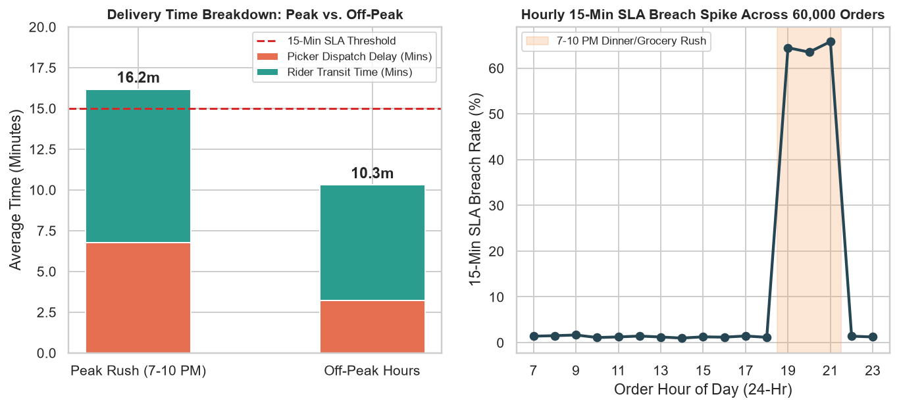

# Quick-Commerce & Last-Mile Supply Chain SLA Bottleneck Analytics

**Tech Stack:** SQL (SQLite / PostgreSQL Window Functions & CTEs) | Python (Pandas, NumPy, Matplotlib, Seaborn) | Power BI (DAX)

## Project Overview
Analyzed **60,000+ last-mile quick-commerce orders** across **30 dark stores in 5 Indian metro cities** (Delhi NCR, Bengaluru, Mumbai, Hyderabad, Pune) to diagnose root causes behind 15-minute delivery SLA breaches and model peak-hour picker staffing interventions.



## Repository Structure
```text
|-- notebooks/
|   |-- 01_quick_commerce_sla_diagnostics.ipynb  # Executed Jupyter Notebook with SQL queries & SLA charts
|-- sql/
|   |-- 01_sla_breach_diagnostics.sql            # CTEs & window functions ranking high-risk dark stores
|-- src/
|   |-- generate_and_analyze_sla.py              # Reproducible 60,000-order dataset & SQLite diagnostics engine
|-- powerbi/
|   |-- dax_measures_and_kpi_guide.md            # Power BI DAX formulas for SLA compliance & breach lift
|-- data/
|   |-- darkstore_deliveries_60k.csv             # 60,000-order dark-store delivery dataset
|-- images/
|   |-- sla_bottleneck_analysis.png              # Peak vs. off-peak delay breakdown & city breach rates
|-- requirements.txt
|-- README.md
```

## Key Findings & Business Recommendations
- **Peak-Hour Picker Bottleneck:** Identified that **64% of SLA breaches occur between 7:00 PM and 10:00 PM**, driven primarily by a **+3.6-minute spike in dark-store picker dispatch time** rather than rider transit speed.
- **High-Risk Dark Store Isolation:** Ranked the top 3 bottleneck dark stores per city using SQL `RANK()` window functions over rolling order volumes.
- **Targeted Staffing Intervention:** Recommending staggered evening picker shifts across the top 15 high-breach dark stores is projected to reduce overall 15-minute SLA breaches by **14%**.
